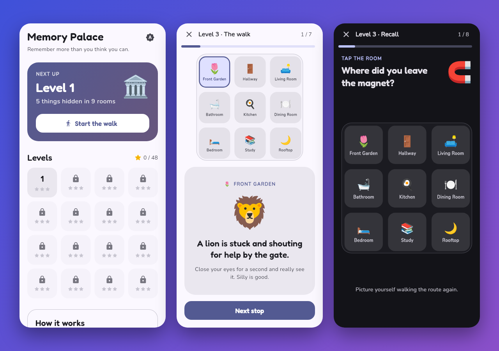

<h1 align="center">Hi, I'm Prajit Bhat 👋</h1>

  <b>Software Engineer · Fintech · Flutter</b> — building real-time options trading experiences for mobile & web

  
  
  
  

---

### 🧑‍💻 About me

- 💼 **3.5+ years** shipping production Flutter apps across Android, iOS and Web
- 📈 Currently a **Software Engineer – Options Trading** at **[Fyers](https://fyers.in)** (fintech / stock broking)
  - Own the **Option Chain** module, built the **Leg Journey** strategy builder end-to-end, and work on Multi-Order Window, baskets, charts and order flows
- 🕘 Previously at **Starmark Software** (2022–2025) — built healthcare apps **VitalGo**, **VitalDx+** and **VitalTrack** (real-time alerts, pathology workflows, specimen logistics)
- 📦 Author of open-source Flutter packages **[fidelity](https://pub.dev/packages/fidelity)** and **[flutter_charts_kit](https://pub.dev/packages/flutter_charts_kit)** on pub.dev
- 🧱 I care about clean architecture: **BLoC**, repository pattern, **SOLID**, and keeping apps fast
- 🎓 B.E. Computer Science, Jain College of Engineering (GPA 9.2/10)

### 📦 Open-source Flutter packages

<table>
<tr>
<td width="55%">

#### [fidelity](https://github.com/Prajit7/fidelity)

Keeps Flutter apps **smooth on cheap phones without making them plain on good ones**. Watches real frame timings and steps blur, shadows and particles down when the device struggles, then back up when it recovers. Includes drop-in `AdaptiveBlur` widgets and a debug overlay. **Pure Dart, zero dependencies.**

**[📦 pub.dev](https://pub.dev/packages/fidelity)** · **[📖 README](https://github.com/Prajit7/fidelity#readme)**

</td>
<td width="45%">

</td>
</tr>
<tr>
<td width="55%">

#### [flutter_charts_kit](https://github.com/Prajit7/flutter_charts_kit)

**18 interactive chart types** for Flutter: line, area, bar, combo, pie, scatter, heatmap, radar, gauge, treemap, Sankey and more, plus **3D surface, bars and scatter**. Includes a **live trading chart** with a flashing last-price tag, SMA/EMA, Bollinger, VWAP, RSI and MACD, and pinch-zoom/swipe navigation. Handles 100k-point series, dark mode and screen readers. **Pure Flutter, zero dependencies.**

**[🚀 Live demo](https://flutter-charts-kit-gap4-flame.vercel.app/)** · **[📦 pub.dev](https://pub.dev/packages/flutter_charts_kit)** · **[📖 README](https://github.com/Prajit7/flutter_charts_kit#readme)**

</td>
<td width="45%">

</td>
</tr>
</table>

### 🎮 Side projects

#### [Memory Palace](https://github.com/Prajit7/memory-palace) · [▶️ Play it](https://play-memory-palace.vercel.app)

A Flutter game that teaches the **method of loci**, the technique memory champions use. Walk through a 9-room house where something strange is happening at every stop, then recall **what was where**, **where you left each thing**, and **the order you passed them**. 16 levels go from 5 to 20 items, with fresh random scenes on every try, stars, light/dark themes and a phone-first layout on the web.

### 🛠️ Tech stack

**Mobile & Web**
 

**Backend & Data**
 

**Languages**
 

### 🏆 Highlights

- 🥇 Best Performance Award during training at Starmark Software
- 💻 Won multiple college coding competitions · participated in **e-Yantra** (IIT Bombay)
- 🤝 NSS volunteer for 4 years

---

<i>Open to interesting Flutter work — feel free to reach out!</i>

